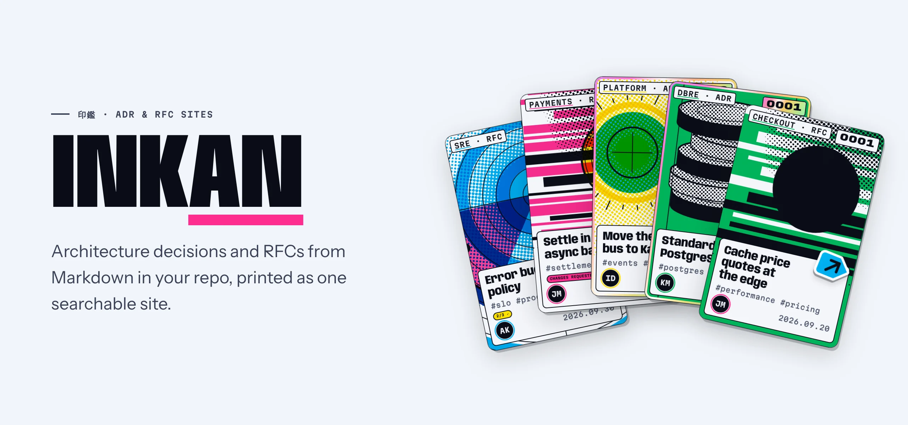
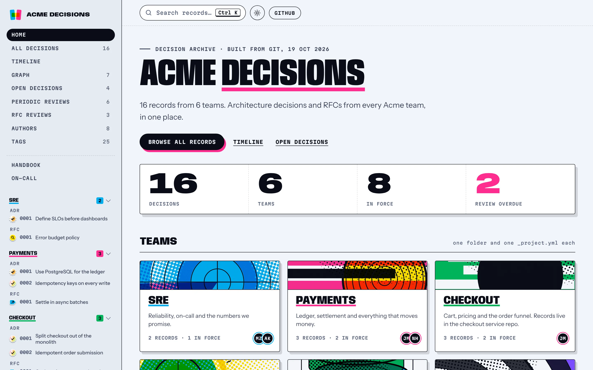
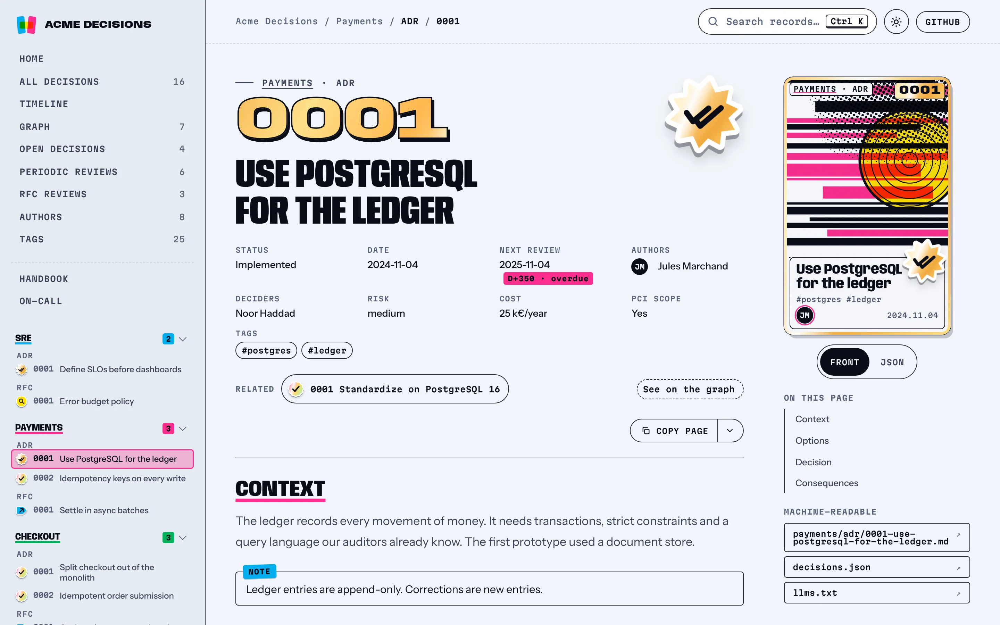
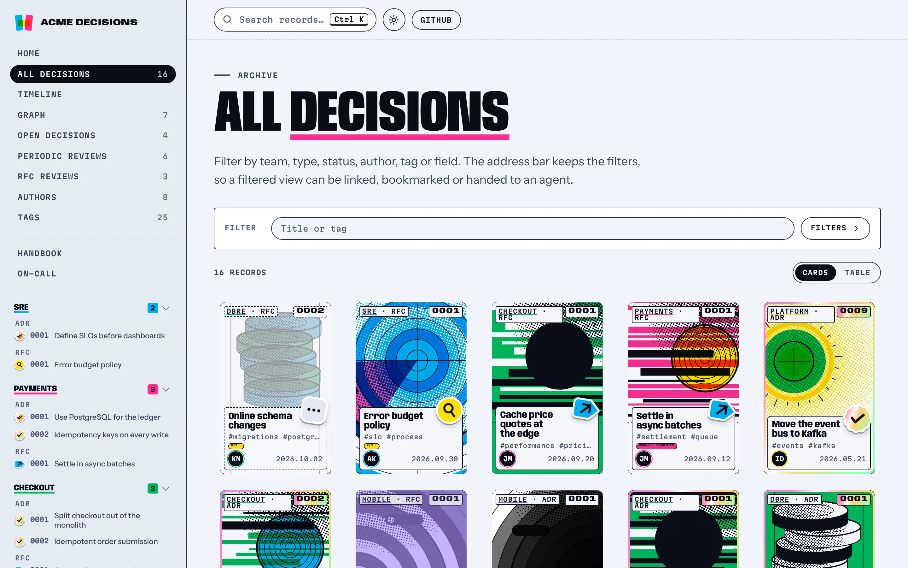
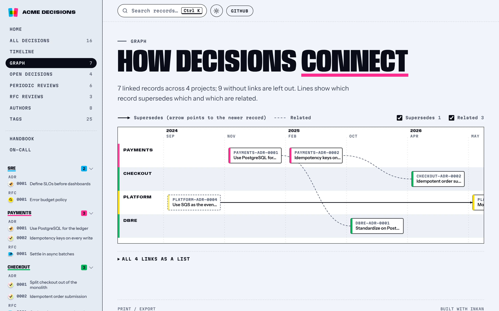

<p align="center">
  <a href="https://github.com/tilaven/inkan">
    <picture>
      <source media="(prefers-color-scheme: dark)" srcset=".github/assets/hero-dark.webp">
      
    </picture>
  </a>
</p>

<p align="center">
  <a href="https://github.com/tilaven/inkan/blob/main/LICENSE"></a>
  <a href="https://www.npmjs.com/package/@tilaven/inkan"></a>
  <a href="https://www.npmjs.com/package/@tilaven/create-inkan"></a>
  <a href="https://github.com/tilaven/inkan/actions/workflows/ci.yml"></a>
  
</p>

<p align="center">
  <strong>
    <a href="#-try-it-right-now">Quick start</a> ·
    <a href="#-features">Features</a> ·
    <a href="https://useinkan.dev">Docs</a> ·
    <a href="#-a-look-around">Screenshots</a> ·
    <a href="#-contributing">Contributing</a> ·
    <a href="#-motivation">Motivation</a>
  </strong>
</p>

# Inkan

**Decisions deserve a home as good as your API docs.**

Inkan (印鑑, the seal that makes a document official) turns a folder of Markdown Architecture Decision Records and
RFCs into a fast, searchable static site. Every team gets its own folder, every record its own printed cover, and the
whole company gets one place to find out why things are the way they are.

- 🆓 Free and open source, MIT licensed
- 📝 Plain Markdown in your repo: no database, no CMS, reviewed in pull requests like code
- 🏢 One site for every team: SRE, Payments, Infra, DBRE… a folder each
- ⚡ Up and running with one command, deployed anywhere that serves static files
- 🧩 Extensible with plugins, component overrides, custom pages and CSS tokens
- 🤖 Readable by people and by agents: `llms.txt`, `decisions.json` and an MCP server

## 🤩 Try it, right now!

```bash
npm create @tilaven/inkan@latest my-decisions
cd my-decisions && npm install && npm run dev
```

Open http://localhost:4321 and you are looking at your own decision archive, with a sample project to edit.

Want to see a full site first? Run the demo content from this repository:

```bash
docker build -t inkan-example . && docker run -p 8080:80 inkan-example
```

## ✨ Features

**Writing**

- GitHub and GitLab flavoured Markdown, Mermaid diagrams, math, code highlighting, `> [!NOTE]` alerts and `:::note` admonitions
- Record type comes from the folder: `adr/`, `rfc/`, or your own (`postmortem/`, `guides/`…)
- Status lifecycle, supersedes / superseded by, related records, linked by path or by plain relative Markdown links
- Custom metadata fields (risk, cost, data class…) validated at build time and filterable on the index
- Dates and authors filled from git, issue keys turned into links, `@adr` references from your code back to the record

**Reading**

- Full-text search with Pagefind built in, or Algolia, Meilisearch, Typesense and your own provider
- Filters by team, type, status, author, tag and custom field, kept in the URL so a view can be shared
- Landing page, timeline, decision graph, authors and tags pages, RSS feed and sitemap
- Status history from git, Open Graph cards for links shared in Slack or Teams, print and PDF export
- Day and Stage themes, built for keyboard and screen reader users (WCAG 2.2 AA), interface in English and Polish

**Running the process**

- Open decisions with deadlines, periodic reviews of decided records, RFC reviews with a "Waiting on you" view
- Comments under RFCs with giscus, GitLab or your own provider, pull request review comments pinned to paragraphs
- `inkan check` in CI for broken references, numbering, statuses and metadata
- Slack, Teams or webhook notifications when a decision is accepted
- Records pulled in from other repositories, sign-in and protected projects for what must stay internal
- Import from log4brains, MADR and adr-tools

**Built for agents too**

- `llms.txt`, `llms-full.txt`, `decisions.json` and a Markdown copy of every page
- `inkan mcp`: an MCP server over your content folder or a published site
- A "Copy page" menu that hands a record to Claude or ChatGPT, and an `AGENTS.md` for coding agents in your repo

## 📸 A look around

<table>
  <tr>
    <td width="50%">
      <picture>
        <source media="(prefers-color-scheme: dark)" srcset=".github/assets/home-dark.webp">
        
      </picture>
      <p align="center"><strong>Landing page</strong><br>Counters, teams and the latest records, configured from one file.</p>
    </td>
    <td width="50%">
      <picture>
        <source media="(prefers-color-scheme: dark)" srcset=".github/assets/record-dark.webp">
        
      </picture>
      <p align="center"><strong>Record page</strong><br>Status, review dates, custom fields and links at a glance.</p>
    </td>
  </tr>
  <tr>
    <td width="50%">
      <picture>
        <source media="(prefers-color-scheme: dark)" srcset=".github/assets/decisions-dark.webp">
        
      </picture>
      <p align="center"><strong>All decisions</strong><br>Filter by anything, as cards or as a table.</p>
    </td>
    <td width="50%">
      <picture>
        <source media="(prefers-color-scheme: dark)" srcset=".github/assets/graph-dark.webp">
        
      </picture>
      <p align="center"><strong>Decision graph</strong><br>Which record supersedes which, across teams and over time.</p>
    </td>
  </tr>
</table>

## ⚙️ Installation

### ⚡️ Quick start

```bash
npm create @tilaven/inkan@latest my-decisions
```

You get `inkan.config.ts`, a sample project, an `AGENTS.md`, CI files for GitHub Actions and GitLab CI, and a
`Dockerfile` with `nginx.conf`. Inkan needs Node.js 22.22 or newer.

### 📦 In an existing repository

```bash
npm install -D @tilaven/inkan
npx inkan init
```

Files that already exist are left alone.

### 🗂️ Your repository

```
inkan.config.ts                ← the only config file
decisions/
  _authors.yml                 ← optional: handle → name, team, avatar
  _landing.md                  ← optional: extra section on the home page
  sre/
    _project.yml               ← name, description, icon, owners, links
    adr/0001-define-slos.md    ← type = folder name (adr, rfc, or your own)
    rfc/0001-error-budget.md
    guides/on-call.md          ← any other Markdown page works too
templates/adr.md               ← optional: your own templates for `inkan new`
```

New project = new folder. New record = new file. Nothing else to register.

## 🧰 Commands

| Command | What it does |
| --- | --- |
| `inkan dev` | Dev server with hot reload (`--port`, `--host`) |
| `inkan build` | Static site in `dist/` (fails on invalid front matter) |
| `inkan preview` | Serve `dist/` locally, including search |
| `inkan new adr sre "Title"` | Next numbered record from a template (`--author`) |
| `inkan init [dir]` | Config, sample project, AGENTS.md, CI files for GitHub and GitLab, Dockerfile and nginx.conf |
| `inkan status sre/adr/1 accepted` | Change a record's status in place (`--date`, `--dry-run`) |
| `inkan supersede <old> <new>` | Link two records as superseded / superseding, both files at once (`--date`, `--dry-run`) |
| `inkan import <dir> --project <name>` | Convert log4brains, MADR or adr-tools records (`--type`, `--format`, `--dry-run`) |
| `inkan rfc-review <record> <reviewer> approve` | Record a reviewer's answer (`approve`, `request-changes`, `reset`; `--note`, `--dry-run`); `--for <handle>` lists records waiting on someone |
| `inkan reviewed <record>` | Record a periodic review of a decided record (`--next`, `--every`, `--date`, `--dry-run`) |
| `inkan reviews` | List decided records whose review is overdue or due soon (`--within`, `--all`, `--json`) |
| `inkan check` | Validate references, numbering, statuses, review schedules and project metadata (`--strict`, `--format json`) |
| `inkan notify` | Post to Slack, Teams or a webhook when records become `accepted` (`--since`, `--dry-run`) |
| `inkan sync` | Fetch the records listed in `sources` |
| `inkan export` | All current decisions as one self-contained HTML file, or a PDF with `--pdf` |
| `inkan mcp` | MCP server (stdio) for agents, over the content folder or a published site (`--url`) |

## 📝 Writing a record

```yaml
---
title: Use Stripe as the primary payment provider   # required
description: One-line summary for lists, search and llms.txt
status: accepted          # draft | proposed | in-review | accepted | implemented | rejected | withdrawn | deprecated | superseded
date: 2026-01-18
authors: [piotr.nowak]
tags: [payments, vendor]
related: [dbre/adr/0001-postgresql-as-default-database]   # path inside decisions/, no extension
---
```

<details>
<summary>All front matter fields</summary>

```yaml
---
title: Use Stripe as the primary payment provider   # required
description: One-line summary for lists, search and llms.txt
status: accepted          # draft | proposed | in-review | accepted | implemented | rejected | withdrawn | deprecated | superseded
date: 2026-01-18
authors: [piotr.nowak]
deciders: [tomasz.wojcik]
tags: [payments, vendor]
supersedes: [team-payments/adr/0000-old-choice]     # path inside decisions/, no extension
supersededBy: []
related: [dbre/adr/0001-postgresql-as-default-database]
reviewBy: 2026-11-15      # open record: decision deadline (backlog); decided record: next review
reviewEvery: 1 year       # periodic review of a decided record (or set it per project / site)
reviewed: 2026-10-01      # last review, written by `inkan reviewed`
reviewers:                # RFC reviewers: list of handles, or handle: pending | approved | changes-requested
  ania: approved
  marek: pending
draft: false              # true hides the page from production builds
---
```

Links between records can also be plain relative Markdown links (`[see](../rfc/0001-x.md)`):
they work when browsing the repo on GitHub or GitLab and on the site.

</details>

## 🔧 Configuration

```ts
// inkan.config.ts
import { defineConfig } from '@tilaven/inkan';

export default defineConfig({
  title: 'Acme Decisions',
  tagline: 'Architecture decisions from every team.',
  url: 'https://decisions.acme.dev',
  repo: { url: 'https://github.com/acme/decisions', branch: 'main', provider: 'github' },
});
```

<details>
<summary>More options</summary>

```ts
export default defineConfig({
  // …
  contentDir: 'decisions',
  locale: 'pl',                                // interface language: 'en' and 'pl' built in, others via translations
  logo: './brand/logo.svg',
  customCss: ['./brand/theme.css'],            // override any --inkan-* CSS variable
  issueLinks: [{ pattern: '\\b(PAY-\\d+)\\b', url: 'https://acme.atlassian.net/browse/$1' }],
  docTypes: { adr: { … }, rfc: { … }, postmortem: { label: 'PM', plural: 'Postmortems', description: 'Postmortem' } },
  statuses: { … },                             // replaces the default list
  reviews: { every: '1 year', soon: 30 },      // periodic review of every decided record
  landing: { sections: ['stats', 'projects', 'latest', 'content', 'agents'] },
});
```

All options with their defaults are in [`packages/inkan/lib/index.d.ts`](packages/inkan/lib/index.d.ts) and in the
[configuration reference](docs/decisions/configuration.md).

</details>

## 🎨 Covers and motifs

Every record gets a risograph-style cover, generated at build time as inline SVG from the record's id: a motif drawn
in the team's ink on a random card stock, the same on every build. Each project gets an (ink, motif) pair no other
project has, so teams stay easy to tell apart.

Motifs carry team keywords, so a project called `security`, `frontend` or `dbre` gets a matching picture (a shield,
a browser window, database discs) without any configuration. Pin either or both in `_project.yml`:

```yaml
# decisions/payments/_project.yml
name: Payments
ink: m          # c, m, y, g, v or o
motif: ticker   # a built-in or a plugin motif
```

<details>
<summary>Draw your own motif</summary>

A plugin adds motifs with `motifs`. A motif is a function that draws on a canvas with ink classes (`a` main ink,
`b` alt ink, `k` black, `p` paper, `sa`/`sk` strokes, `n` no fill, `x` blend) instead of colours, so one print works
in both themes. `record` and `project` are seeded random generators: use the first for what varies per record, the
second for what all covers of a team share.

```ts
// plugins/stamp.ts
import { defineMotif } from '@tilaven/inkan';
import { circle, n } from '@tilaven/inkan/covers';

export default defineMotif((c, record, project) => {
  const cx = c.w * (project() < 0.5 ? 0.3 : 0.7);
  const cy = c.h * (0.3 + record() * 0.1);
  c.halftone({ spacing: 5, angle: 0.6, maxR: 2.6, cls: 'a', field: { cx, cy, r: c.w, pow: 1.3, amp: 1.1 } });
  c.add(circle(cx, cy, c.w * 0.3, ' class="b x"'));
  c.add(`<path class="sk n" stroke-width="2" d="M${n(cx - 40)} ${n(cy)}H${n(cx + 40)}"/>`);
}, { keywords: ['audit', 'controls'] });

// plugins/acme.ts
import { definePlugin } from '@tilaven/inkan';

export default definePlugin({ name: 'acme', motifs: { stamp: new URL('./stamp.ts', import.meta.url) } });
```

Motif names are lowercase (`/^[a-z][a-z0-9-]*$/`); a plugin may replace a built-in name. An unknown `motif:` fails
the build and lists the available names. Pinned projects are reserved first, so adding a pin can change the pair of
an unpinned project.

</details>

## 🚀 Deploying

`inkan build` writes plain HTML and CSS, plus small scripts for search, diagrams and filters, to `dist/`.
`init` adds ready workflows for **GitHub Pages** and **GitLab Pages**, and a `Dockerfile` for nginx. Anything that
serves static files works: S3, Netlify, Cloudflare Pages, your own server. Set `BASE_PATH=/sub/path` when the site
is not at the domain root.

## 🧩 How it works

Inkan is a CLI with a complete site inside the package, built on [Astro](https://astro.build) as a static HTML
compiler. Your repository only holds content and `inkan.config.ts`; the CLI runs Astro with the app from the package
and your config injected as a virtual module. Search is [Pagefind](https://pagefind.app), code blocks are
[Expressive Code](https://expressive-code.com), diagrams are [Mermaid](https://mermaid.js.org).

## 📚 Documentation

The docs are online at [useinkan.dev](https://useinkan.dev) and are an Inkan site themselves: every feature is
described as an ADR, with why it exists, what was decided and how to use it. Start with the
[introduction](https://useinkan.dev/introduction/) and the [quick start](https://useinkan.dev/quick-start/). The
sources live in [`docs/`](docs); run them locally with `npm run docs:dev`.

## 🤝 Contributing

Issues and pull requests are welcome. This repository is a monorepo:

```
packages/inkan                 the CLI and the site (published to npm)
packages/create-inkan          `npm create @tilaven/inkan`
examples/company-decisions     demo content
docs                           the documentation site, written as ADRs
```

```bash
npm install
npm run dev          # the example against the local package
npm run docs:dev     # the documentation site
npm test             # unit tests
npm run test:e2e     # end-to-end and accessibility tests
```

A feature that lands also adds or updates its ADR in `docs/decisions/`.

## 🎯 Motivation

Architecture decisions tend to end up scattered across wikis, chat threads and slide decks, where nobody finds them
when it matters. Keeping them as Markdown next to the code fixes the writing part, but a folder of files is a poor
place to read them. Inkan gives those files what API references have had for years: a site that is pleasant to
browse, quick to search and easy to run, without taking the records out of the repository.

## 📄 License

Inkan is [MIT licensed](LICENSE).
