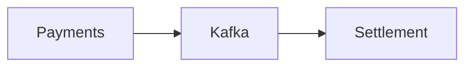
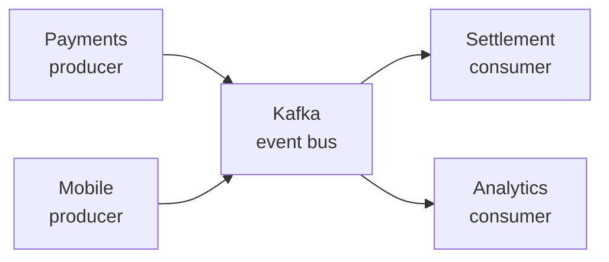
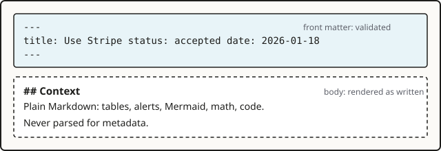

## Context

Records are read in two places: rendered on the site and as source files on GitHub or GitLab. A syntax that renders on the site but shows up as raw text in a pull request slows down review. At the same time decisions need tables, diagrams, formulas and annotated code, which plain CommonMark does not give.

## Decision

Records are GitHub-flavoured Markdown (tables, task lists, strikethrough, autolinks, footnotes), plus the extensions GitHub and GitLab render themselves: `> [!NOTE]` alerts, ```` ```mermaid ```` diagrams and `$` math. Zudoku and Docusaurus `:::note` admonitions work too and render as the same callout. Code blocks are highlighted by Expressive Code with GitHub-compatible meta strings. Everything on this page is produced by the Markdown source of this file; open "Raw Markdown" at the bottom to compare.

`.mdx` files are supported too, see [MDX components without imports](../../extending/adr/0004-mdx-components-without-imports.md). The features below need no MDX.

## How to use it

### Tables

```md
| Option | Replay | Ops cost | Verdict |
| --- | :---: | ---: | --- |
| Keep SQS | No | Low | Rejected |
```

| Option | Replay | Ops cost | Verdict |
| --- | :---: | ---: | --- |
| Keep SQS | No | Low | Rejected |
| Kafka | Yes | High | **Accepted** |
| NATS JetStream | Yes | Medium | ~~Shortlisted~~ Dropped |

Column alignment with `:---:` and `---:` works. Inline formatting inside cells works too. A table wider than the page scrolls sideways and, while it does, is a focusable region named "Table 1 in &lt;record title&gt;", "Table 2 in &lt;record title&gt;" and so on, so it can be reached and moved with the keyboard; a table that fits is left alone. Display math gets the same treatment as "Equation 1 in &lt;record title&gt;".

### Task lists

```md
- [x] Migration script written
- [ ] Consumers switched over
```

- [x] Migration script written
- [x] Topic retention agreed with Payments
- [ ] Consumers switched over
- [ ] SQS queues deleted

The boxes are read-only. A rehype plugin (`rehype-task-labels`) gives each one an `aria-label` of "Done" or "Not done" so screen readers announce the state.

### Footnotes

```md
Kafka keeps messages for the configured retention[^retention].

[^retention]: Seven days by default; the ledger topics use 30.
```

Kafka keeps messages for the configured retention[^retention]. Footnotes are collected at the end of the page[^gfm].

[^retention]: Seven days by default; the ledger topics use 30.
[^gfm]: Part of GitHub-flavoured Markdown, which Astro enables for all `.md` files.

### Alerts

```md
> [!NOTE]
> Useful information the reader should know.
```

> [!NOTE]
> Useful information the reader should know, even when skimming.

> [!TIP]
> Helpful advice for doing things better.

> [!IMPORTANT]
> Key information the reader needs to achieve the goal.

> [!WARNING]
> Urgent information that needs attention to avoid problems.

> [!CAUTION]
> Advises about risks or negative outcomes of an action.

The five GitHub alert types are supported. On GitHub and GitLab the same syntax renders the same boxes.
GitLab's custom titles work as well: write the title after the marker.

```md
> [!tip] Start small
> One availability SLO per service tier is enough.
```

> [!tip] Start small
> One availability SLO per service tier is enough.

### Admonitions

If your team writes Zudoku, Docusaurus or Starlight docs, the `:::` block form renders as the same callout.
The title goes in `{title="..."}` or in brackets.

```md
:::danger{title="Do not"}
Never rewrite the decision of an accepted record. Supersede it.
:::

:::info[Bracket title]
Nested callouts use more colons on the outer block (`::::`).
:::
```

:::danger{title="Do not"}
Never rewrite the decision of an accepted record. Supersede it.
:::

:::info[Bracket title]
Nested callouts use more colons on the outer block (`::::`).
:::

| Type | Label | Styled as |
| --- | --- | --- |
| `note`, `tip`, `info`, `important`, `warning`, `caution`, `danger` | their own name | themselves |
| `sparkles` | New | `important` |
| `rocket` | Launch | `tip` |
| `settings` | Settings | `note` |
| `zap` | Heads up | `warning` |
| `lock` | Security | `danger` |
| `megaphone` | Announcement | `info` |

Every callout gets `.markdown-alert.markdown-alert-<type>`, the same markup GitHub uses, so one CSS rule styles
both syntaxes. Only the `:::` block form is parsed: `word:name` and `::` in prose stay plain text. A `:::` block
with any other name is left for remark plugins, which claim it by setting `data.hName`; unclaimed ones keep
their fences as text.

> [!NOTE]
> On GitHub and GitLab, `:::` blocks render as plain paragraphs. Prefer `> [!NOTE]` alerts when records are also
> read in the repository.

### Mermaid diagrams

````md

````



Diagrams are rendered in the browser and follow the site's light and dark theme. The Mermaid library is loaded only on pages that contain a diagram. Every diagram type Mermaid supports works: `sequenceDiagram`, `stateDiagram-v2`, `erDiagram`, `gantt` and so on.

### Math

```md
Inline: the error budget is $1 - \text{SLO}$.

$$
\text{burn rate} = \frac{\text{errors observed}}{\text{errors allowed}}
$$
```

Inline: the error budget is $1 - \text{SLO}$, so a 99.9% SLO leaves $0.1\%$ of requests.

$$
\text{burn rate} = \frac{\text{errors observed in the window}}{\text{errors allowed in the window}}
$$

Formulas are typeset with KaTeX at build time; no script runs in the browser.

### Code blocks

Fenced code with a language gets syntax highlighting. The meta string after the language is read by Expressive Code:

````md
```sql title="ledger_entries.sql" {2} del={3} ins={4}
CREATE TABLE ledger_entries (
  id          bigint GENERATED ALWAYS AS IDENTITY PRIMARY KEY,
  amount      numeric(12, 2),
  amount_minor bigint NOT NULL,
  created_at  timestamptz NOT NULL DEFAULT now()
);
```
````

```sql title="ledger_entries.sql" {2} del={3} ins={4}
CREATE TABLE ledger_entries (
  id          bigint GENERATED ALWAYS AS IDENTITY PRIMARY KEY,
  amount      numeric(12, 2),
  amount_minor bigint NOT NULL,
  created_at  timestamptz NOT NULL DEFAULT now()
);
```

| Meta | Effect |
| --- | --- |
| `title="file.ts"` | File name tab above the block. |
| `{2}`, `{2, 5-7}` | Highlight those lines. |
| `ins={4}`, `del={3}` | Mark lines as added or removed, diff style. |
| `"text"` | Highlight every occurrence of the text. |
| `showLineNumbers=false` | Hide line numbers. They are on by default. |
| `wrap` | Soft-wrap long lines. Off by default. |

Code blocks without a language are rendered as plain text. ` ```text ` is the explicit form. Inline code like `inkan.config.ts` is just backticks. A block that scrolls sideways is a focusable region named after its title or language ("Code block 2: ledger_entries.sql"), so keyboard users can reach it and screen readers can tell the blocks apart.

### Images

```md

```


Relative image paths are resolved from the Markdown file, optimised at build time and copied to `dist/`. A folder whose name starts with `_` is a good place for them: it is never treated as pages. Absolute URLs (`https://...`) are used as written.

### Also supported

- Headings get an id from their text and a `#` anchor on hover, so `[see Consequences](#consequences)` works; the table of contents lists `h2` and `h3`.
- Strikethrough with `~~text~~`, autolinked bare URLs such as https://example.com, and HTML comments `<!-- like this -->`, which are dropped.
- Relative links to other `.md` files, see [Link records by path](0006-link-records-by-path.md).
- Issue keys that become links, see [Turn issue keys into links](0008-turn-issue-keys-into-links.md).
- Raw HTML in Markdown is passed through as on GitHub.

## Consequences

- One source renders in three places (site, GitHub, GitLab) with the same meaning, so review happens where the pull request is.
- Expressive Code meta strings (`title=`, `{2}`) are ignored by GitHub; the block still renders there, without the decoration.
- Math and Mermaid syntax inside a record is rendered by GitHub, but GitLab and GitHub differ in details. Keep diagrams simple when the repository view matters.
- Mermaid runs in the browser. Readers without JavaScript see the diagram source.
