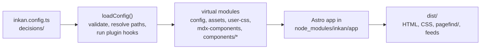

## Context

Most static site generators expect you to own the site: a `src/` folder, layouts, a framework config and a dependency list that you keep up to date. A decision log is maintained by many people who are not front-end developers. They should only touch Markdown and one config file, and an upgrade should be `npm update`. Zudoku solved this for API docs by shipping the whole app inside the package and running it from a CLI; Inkan needed the same shape for decisions.

## Decision

Inkan is one npm package, `inkan`, with an `inkan` binary. The package contains the complete site (an Astro application in `app/`), the built-in templates and the starter files. Your repository holds content and `inkan.config.*` and nothing else. The CLI runs Astro programmatically with the app folder inside the package as the Astro root and your folder as the source of content and config.

Your config reaches the app through virtual modules, the same model Zudoku uses with Vite. There is no generated code in your repository, no `src/` and no framework config to maintain.

## How to use it

### Install

```bash
npm install -D inkan
```

The package requires Node.js 22.22 or newer. Astro, Pagefind, Mermaid, KaTeX and Expressive Code are dependencies of the package; you do not install them yourself.

### Commands

| Command | What it does |
| --- | --- |
| `inkan dev` | Starts the dev server with hot reload, by default on `http://localhost:4321`. With `authentication`, `--public` shows what anonymous visitors see. |
| `inkan build` | Builds the static site into `dist/` next to the config file. Fails on invalid config or front matter. |
| `inkan preview` | Serves the built `dist/` locally, including the search index. When `dist-protected/` exists it starts the sign-in server instead. |
| `inkan serve` | Production server for a built site: `dist/` as static files, and sign-in for protected pages when the site was built with `authentication`. Default port 8080. See [Sign-in and protected projects](../../deploy/adr/0007-sign-in-and-protected-projects.md). |
| `inkan new <type> <project> "<title>"` | Creates the next numbered record. See [Number records with inkan new](0003-number-records-with-inkan-new.md). |
| `inkan init [dir]` | Scaffolds a repository. See [Scaffold with init and npm create](0002-scaffold-with-init-and-npm-create.md). |
| `inkan status <record> <status>` | Changes one record's status in place. See [Change status and supersede from the CLI](0005-change-status-and-supersede-from-the-cli.md). |
| `inkan supersede <old> <new>` | Marks `<old>` as superseded by `<new>` and links both files. Same record. |
| `inkan import <dir> --project <name>` | Converts log4brains, MADR or adr-tools records into a project. See [Import from log4brains, MADR and adr-tools](0006-import-from-log4brains-madr-and-adr-tools.md). |
| `inkan reviewed <record>` | Records a periodic review of a decided record: writes `reviewed` and the next review. See [Mark records reviewed from the CLI](0009-mark-records-reviewed-from-the-cli.md). |
| `inkan reviews` | Lists the records whose review is overdue or due soon. Same record. |
| `inkan check` | Validates references, numbering, statuses, dates, review schedules and project metadata without building. See [Check records in CI](0007-check-records-in-ci.md). |
| `inkan sync` | Fetches the records of every `repo` entry in `sources` into the cache. See [Records from other repositories](../../deploy/adr/0005-records-from-other-repositories.md). |
| `inkan export [--pdf]` | Writes every current decision to one self-contained HTML file, or an A4 PDF. See [Print and export](../../site/adr/0008-print-and-export.md). |
| `inkan mcp [--url <site>]` | Serves the records to AI agents over the Model Context Protocol on stdio. See [MCP server for agents](../../ai/adr/0005-mcp-server-for-agents.md). |
| `inkan --version`, `-v` | Prints the package version. |
| `inkan`, `help`, `--help` | Prints the usage text. An unknown command prints it and exits with code 1. |

`init` adds `dev`, `build`, `preview`, `new`, `status`, `supersede` and `check` as npm scripts, so `npm run dev`, `npm run check` and `npm run new -- adr sre "Title"` do the same thing.

`dev`, `build`, `preview` and `init` live in `bin/cli.mjs`; every other command is a module in `lib/commands/<name>.mjs` that exports `run({ args, flags, root })` and returns the exit code. An error thrown by a command is printed on stderr and exits with code 1.

### Options

| Option | Applies to | What it does |
| --- | --- | --- |
| `--root <dir>` | all commands | Folder that holds `inkan.config.*`. Default: the current folder. |
| `--port <number>` | `dev`, `preview`, `serve` | Port to listen on. Default: Astro's 4321, and 8080 for `serve` (or `PORT`). |
| `--public` | `dev` | Hide protected records, as anonymous visitors see the site. |
| `--host [address]` | `dev`, `preview`, `serve` | Listen on all interfaces (`--host`) or on one address (`--host 0.0.0.0`). Useful in containers and for testing from a phone. |
| `--offline` | `build` | Keep the cached copies of `repo` sources instead of fetching them. Fails when a source has never been fetched. |
| `--author <handle>` | `new` | Author written into the new record instead of the one matched from the Git user. |
| `--date [YYYY-MM-DD]`, `--dry-run` | `status`, `supersede` | Also set `date` to today, or to the given day, on the record whose status changes; print the diff instead of writing. |
| `--next <date>`, `--every <interval>`, `--date <date>`, `--dry-run` | `reviewed` | Next review date; review interval; the review date instead of today; preview. |
| `--within <days>`, `--all`, `--json` | `reviews` | Due-soon window; list every scheduled record; JSON output. |
| `--project`, `--type`, `--format`, `--dry-run` | `import` | Target project and type, source dialect, preview. |
| `--strict`, `--format json` | `check` | Fail on warnings; print a JSON report. |
| `--out <file>`, `--pdf`, `--no-build` | `export` | Output path, PDF instead of HTML, reuse the existing `dist/`. |
| `--url <site>` | `mcp` | Read a published site instead of the local content folder. |

Flags take their value from `--port 3000` or `--port=3000`; `--root`, `--out`, `--project`, `--url` and `--author` must have one. `--date` takes the next argument as its value when there is one, so write it after the positionals (`inkan status sre/adr/1 accepted --date`), and an argument the command does not expect is refused. Example:

```bash
npx inkan dev --root docs --port 3000 --host
```

This is how the Inkan repository builds this site: the config is `docs/inkan.config.ts`, so the root is `docs`.

### What happens on `dev` and `build`



1. The CLI sets `INKAN_ROOT` to the resolved root. When `sources` lists `repo` entries, `build` fetches every one of them first (unless `--offline`) and `dev` fetches the missing ones. Then it calls Astro's `dev`, `build` or `preview` with `root` pointing at the app inside the package.
2. `app/astro.config.mjs` loads and validates your config, then registers a Vite plugin that serves it as virtual modules:
   - `virtual:inkan/config`: the resolved config as JSON (plugins stripped).
   - `virtual:inkan/assets`: your `logo` and `favicon` as asset URLs.
   - `virtual:inkan/user-css`: imports of every file in `customCss`.
   - `virtual:inkan/mdx-components`: your `mdxComponents` module, or an empty map.
   - `virtual:inkan/components/<Name>`: your override of a component, the built-in one, or an empty slot.
3. Content collections read from your `contentDir` and `pagesDir`. Vite is allowed to read files from your repository root, so images and CSS next to your records work.
4. Output goes to `<root>/dist`; caches go to `<root>/node_modules/.inkan` (including `sources/<project>` clones) and `.vite-inkan`. Astro's telemetry and dev toolbar are off.

The dev server watches the config file and restarts when it changes. Files the config points at (components, CSS, the MDX components module) hot-reload on their own.

### Upgrading

```bash
npm update inkan
```

Because the site is inside the package, a new version brings new pages, styles and fixes without any change to your repository. Options that were removed or renamed are reported by the config validation, with a hint, the next time you run `dev` or `build`.

## Consequences

- Zero site code in your repository. Content authors see only Markdown and one config file.
- Upgrades are a version bump. Breaking config changes surface as validation errors, not silent misbehaviour.
- Customisation goes through defined seams: config, `customCss`, component overrides, MDX components and plugins. You cannot edit the app's own files; if a seam is missing, that is a feature request.
- The CLI wraps Astro's programmatic API, so Astro's own CLI flags beyond `--port` and `--host` are not exposed.
- `--root` must point at the folder with the config. Running `inkan dev` from a different folder without it finds no config and builds a site with the defaults and an empty `decisions/` folder.
- The install is heavier than a Markdown linter because the full toolchain (Astro, Mermaid, KaTeX, Pagefind) is a dependency, even if you never use diagrams or math.
