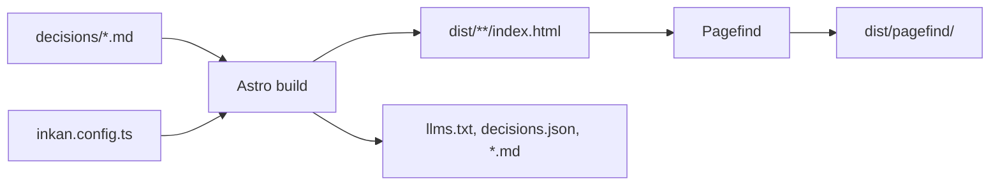

## Context

A decision archive changes a few times a week and is read by many. It should be as cheap to host as a folder
of files and as hard to break as one: no runtime, no database, no secrets on the server. Full-text search is
usually the feature that forces a server; here it must not.

## Decision

`inkan build` runs Astro as a static compiler and writes the whole site to `dist/` next to
`inkan.config.ts`: one `index.html` per page, hashed assets, the machine-readable files and a Pagefind
search index generated from the finished HTML. Everything the browser needs is in that folder. The build fails
instead of publishing a site with invalid front matter or a page collision.

## How to use it

```bash
npx inkan build             # writes ./dist
npx inkan preview           # serves ./dist locally, search included
```

`init` adds both as npm scripts (`npm run build`, `npm run preview`). `--root <dir>` points the CLI at another
folder holding the config.

### What is in dist/

```text
dist/
  index.html                       landing page
  decisions/index.html             record index, filters run in the browser
  timeline/index.html
  backlog/index.html
  authors/index.html
  tags/index.html
  sre/index.html                   one team page per project folder
  sre/adr/0001-define-slos/index.html
  sre/adr/0001-define-slos.md      raw Markdown copy of the record
  handbook/index.html              pages from pagesDir
  export/index.html                every current decision as one print-ready document
  badges/records.svg               README badges, also as shields.io endpoint JSON
  badges/accepted.svg  badges/sre.svg  badges/records.json  ...
  404.html
  llms.txt  llms-full.txt  decisions.json  AGENTS.md  rss.xml
  sitemap-index.xml  sitemap-0.xml
  _astro/                          hashed CSS, JS and images
  pagefind/                        search index and the Pagefind script (default search)
  search.json                      instead of pagefind/, when search uses an external provider
```

URLs always end with a slash (`/sre/adr/0001-define-slos/`), so every page is a folder with an `index.html`.
Files with an extension (`.md`, `.json`, `.txt`, `.xml`, `.svg`) sit next to those folders. Redirects from
`redirects` in the config are HTML pages with a meta refresh.

### Export and badges

`/export/`, linked as "Print / export" in the footer, is one document with a cover, a table of contents and
every record whose status is current (or the statuses in `export.statuses`), grouped by project, one record per
A4 page when printed. It is not indexed by search and not in the sitemap. `inkan export` builds the site
and turns that page into a single self-contained `decisions.html`; `--pdf` writes an A4 PDF instead, `--out`
names the file and `--no-build` reuses an existing `dist/`. The PDF and Mermaid diagrams need the optional
`playwright-core` package and a Chromium (`npm install playwright-core && npx playwright-core install chromium`, or
`PLAYWRIGHT_CHROMIUM_EXECUTABLE_PATH`).

```ts title="inkan.config.ts"
export default defineConfig({
  export: { title: 'Acme architecture decisions', statuses: ['accepted', 'implemented', 'deprecated'] },
});
```

`/badges/` holds flat shields.io-style badges, cached for five minutes by the `Cache-Control` header:

| File | Shows |
| --- | --- |
| `badges/records.svg` | Number of records (labelled with the type's plural when there is one `docTypes` entry) |
| `badges/accepted.svg` | Number of records with a current status |
| `badges/<project>.svg` | Number of records of one project, labelled with its name |

```md


```

Each `.svg` has a `.json` twin in the shields.io endpoint format. A project named `records` or `accepted` gets no
badge of its own, and `badges` cannot be used as a project folder name. The two features in full:
[Print and export](../../site/adr/0008-print-and-export.md) and [README badges](../../site/adr/0009-readme-badges.md).



### Search without a server

After Astro has written the HTML, the build indexes `dist/` with Pagefind and writes the index to
`dist/pagefind/`. The browser loads `pagefind.js` from there and fetches only the index fragments a query
needs. The build log shows `Search index: N pages`. Set `search: false` to skip the index and hide the search
UI. With `search.type` set to `algolia`, `meilisearch`, `typesense` or `custom` the build writes
`dist/search.json`, one record per page for you to push into that service, and no `pagefind/` folder. See
[Full-text search with pluggable providers](../../site/adr/0005-full-text-search-with-pagefind.md).

### What the build checks

The build stops with an error, and exit code 1, when:

- the config has an unknown option, a wrong type or an invalid plugin hook result;
- a record has front matter that fails the schema: missing `title`, a `status` outside your `statuses`, a date
  that does not parse;
- a page in `pagesDir` or a plugin page collides with a built-in page, a record or a redirect;
- a project folder name collides with a built-in page such as `decisions` or `authors`, or with a folder of
  built-in pages such as `badges`.

A pull request pipeline that runs `npm run build` is therefore a front matter linter. `inkan check` goes
further (broken references, duplicate numbers, missing project metadata) without building; the CI files from
`init` run it first.

### Caches

Two folders under `node_modules/` speed up rebuilds: `node_modules/.inkan` (Astro's cache, including
optimised images) and `node_modules/.vite-inkan`. Records pulled from other repositories with `sources`
are cloned into `node_modules/.inkan/sources/<project>` and refreshed by every build unless `--offline`
is set; see [Records from other repositories](0005-records-from-other-repositories.md). Deleting these folders is
always safe. The `_gitignore` that `init` writes already excludes `dist/` and `node_modules/`.

### Hosting

Any static host works: GitHub Pages and GitLab Pages (workflows come with `init`), an S3 or GCS bucket behind
a CDN, nginx in a container, Netlify, Cloudflare Pages. Two things to configure on hosts that do not do it
by default:

- serve `<folder>/index.html` for a request to `<folder>/`;
- serve `404.html` for unknown paths.

See [Docker and nginx](0003-docker-and-nginx.md) for a configuration that does both, and
[Serve from a sub-path](0004-serve-from-a-sub-path.md) when the site is not at the domain root.

## Consequences

- Hosting costs nothing beyond file storage; there is no server to patch and no database to back up.
- The site is only as current as the last build. Every merge needs a build, which is what the generated CI files do.
- Filters, search and the theme switch run in the browser. Without JavaScript the pages still render and link, but the record index does not filter and search is unavailable.
- "Last updated" dates come from `git log` at build time. A shallow clone in CI shows wrong dates; the generated workflows fetch the full history for that reason.
- The build is Node 22 or newer and takes a few seconds for dozens of records; the Pagefind step grows with the number of pages.
