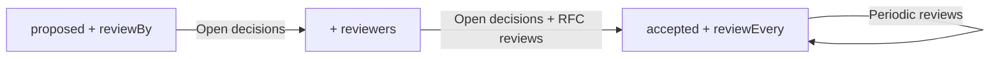

## Context

Three pages list records against a date: `/backlog/`, `/reviews/` and `/rfc-reviews/`. They were added one at a time, and in English two of them were called "Reviews" and "RFC reviews" while the first one was titled "Review backlog". Readers took them for three views of the same list. They are not: each answers a different question for a different person, and the word "review" means something else on each.

## Decision

The sidebar, the header and the landing page name the pages after the question they answer:

| Page | Label | Question |
| --- | --- | --- |
| `/backlog/` | Open decisions | What still waits for a decision? |
| `/reviews/` | Periodic reviews | Is a decision we made still right? |
| `/rfc-reviews/` | RFC reviews | Who still has to review a proposal? |

The URLs stay as they are, so existing links keep working.

## How to use it

### Which records each page lists

| | Open decisions | Periodic reviews | RFC reviews |
| --- | --- | --- | --- |
| Statuses | `open: true` (`draft`, `proposed`, `in-review`) | `reviews.statuses`, else `current: true` (`accepted`, `implemented`) | `open: true` |
| Also needs | nothing | a due date: `reviewBy`, or the last `reviewed` date (else the record's `date`) plus an interval from `reviewEvery` on the record or its project, or `reviews.every` | `reviewers` in front matter |
| Date it sorts by | `reviewBy`, the deadline for the decision | the next review date | `reviewBy` |
| Groups | with a deadline, then "No deadline" | Overdue, Due soon, Scheduled | Waiting on you, In review, Changes requested, Approved |
| Linked when | always | any record has a schedule | any open record has reviewers |

### Where they overlap

Every record on RFC reviews is also on Open decisions, because both list open records only. Open decisions shows such a record with a small review chip ("Review: 2 of 3 approvals"); RFC reviews adds the reviewers' states and the "Waiting on you" view for the person reading.

Periodic reviews shares nothing with the other two under the default statuses: once a record is accepted it leaves Open decisions and RFC reviews, and if it has a schedule it appears on Periodic reviews. Putting an open status into `reviews.statuses` is the only way a record shows on all three.

`reviewBy` is read differently depending on the status. On an open record it is the deadline for the decision; on a decided record it is the date of the next periodic review.

### A record's way through the pages

1. An RFC is written with `status: proposed` and `reviewBy: 2026-11-15`. It is on Open decisions.
2. `reviewers: [ann, marek]` is added. It stays on Open decisions and appears on RFC reviews, where it shows under "Waiting on you" for whichever of them picks themselves on that page.
3. It is accepted with `reviewEvery: 1 year`, and the proposal's `reviewBy` is removed. It leaves both pages and appears on Periodic reviews, due a year after its date. A `reviewBy` left in place would be read as the review date instead, so the record would show as overdue from 15 November.

## Consequences

- Each page keeps one meaning, so a reader who lands on it from a link knows which question it answers.
- The URL `/backlog/` no longer matches its English label. Changing it would break links people already shared.
- A site whose config lists `landing.actions` with the old "Backlog" text keeps that text until the config is changed.
