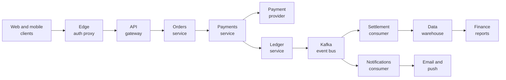
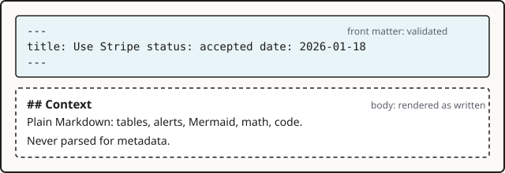

## Context

A record is read in a column about 760 pixels wide. A Mermaid diagram with a dozen boxes in a row is scaled down to fit it, and its labels shrink until nobody can read them. Screenshots and architecture drawings have the same problem. Browser zoom enlarges the whole page and still keeps the diagram inside the column, and on a phone a pinch moves the page instead of the picture.

## Decision

Every image and Mermaid diagram in Markdown can be opened in a full-screen viewer. Clicking it, or the enlarge button in its corner, opens the viewer with the picture fitted to the screen. Photos are never shown larger than their own pixels at first; diagrams and SVG images may grow up to twice their size. From there it zooms up to eight times its own size and pans in any direction.

| Action | Mouse or touch | Keyboard |
| --- | --- | --- |
| Zoom in or out | Wheel, pinch, or the `+` and `−` buttons | `+` and `−` |
| Zoom in on a point | Double-click it. Double-click again to fit. | |
| Fit to the screen | The fit button | `0` |
| Move | Drag, or click a point to bring it to the centre | Arrow keys, with `Shift` for bigger steps |
| Close | The close button | `Esc` |

The viewer is a modal dialog: focus moves into it, stays inside while it is open, and goes back to the enlarge button when it closes. The enlarge button is named after the image's alt text ("Image" when there is none), or for diagrams after their `accTitle`, falling back to "Diagram 1", "Diagram 2". The zoom level is announced after each button or key press, not on every wheel step. Every movement has a single-click way to do it, so nobody has to drag. A diagram is moved into the viewer rather than copied, so its styles keep working and its colours follow the Day and Stage themes.

Images inside a link stay links. Images narrower than 48 pixels, such as badges and icons, and images that fail to load get no button. Printed pages leave the buttons out.

## How to use it

Nothing to configure. Write images and diagrams as usual and they can be enlarged:

Give every image a meaningful alt text: it names the enlarge button and the viewer, and it is what screen readers read out.

## Consequences

- Wide diagrams no longer have to be split up or redrawn vertically to stay readable.
- The viewer is one component with no new dependency. Every page carries its markup, and its script does nothing on pages without an image or a diagram.
- The viewer follows the OVERPRINT look: the picture sits on a dotted paper stage with the hard ink shadow used by cards and the search palette.
