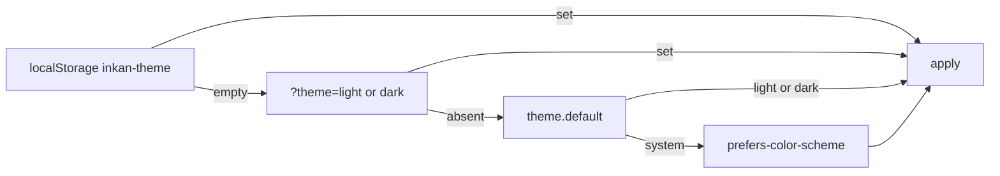

## Context

Readers expect a dark mode, and they expect it to follow the operating system until they say otherwise. A static site has no server to remember the choice, and a theme applied after the first paint flashes the wrong colours. The site also needs a way for a link or a screenshot script to force one theme regardless of what the reader saved.

## Decision

Inkan has two themes, Day (light, ink on paper) and Stage (dark, light on black). The theme is resolved by an inline script before the first paint, in this order: the reader's saved choice, a `?theme=` query parameter, the `theme.default` option, the operating system preference. A toggle in the header switches between the two and saves the choice in the browser.

## How to use it

### The default

```ts title="inkan.config.ts"
export default defineConfig({
  theme: { default: 'system' },
});
```

| Option | Default | What it does |
| --- | --- | --- |
| `theme.default` | `'system'` | Theme for a reader who has not chosen one. `'light'` forces Day, `'dark'` forces Stage, `'system'` follows `prefers-color-scheme`. |

### How a theme is picked



1. The saved choice in `localStorage` under `inkan-theme`, written by the toggle.
2. A query parameter `?theme=light` or `?theme=dark` on the current URL. It wins over the saved choice for that page view but is not saved.
3. `theme.default` when it is `light` or `dark`.
4. The operating system preference when the default is `system`.

The result is written to `<html data-theme="light|dark">` before any content renders, so there is no flash. The HTML element also gets the class `js`, which the CSS uses to show controls that need scripting.

### The toggle

The header has a sun/moon button labelled "Dark theme", a toggle that is pressed (`aria-pressed="true"`) while Stage is on. It flips `data-theme` on the spot and stores the new value in `localStorage`. The choice is per browser; there is no account or cookie.

```text
?theme=dark        force Stage for this view, e.g. for a screenshot or a link in a dark dashboard
?theme=light       force Day
```

### Writing CSS for both themes

Both themes are expressed entirely through tokens. The dark values are defined twice in `tokens.css`: once under `@media (prefers-color-scheme: dark)` for `:root:not([data-theme="light"])`, so a page still looks right before the script runs or without JavaScript, and once for `:root[data-theme="dark"]`. When you override tokens in your own CSS, do the same:

```css title="brand/theme.css"
:root {
  --inkan-bg: #F7F4EE;
}
:root[data-theme="dark"] {
  --inkan-bg: #0B0A08;
}
@media (prefers-color-scheme: dark) {
  :root:not([data-theme="light"]) {
    --inkan-bg: #0B0A08;
  }
}
```

Code blocks, Mermaid diagrams and the covers read the same tokens, so they switch with the page; nothing needs a second palette. The `color-scheme` property is set per theme so form controls and scrollbars follow.

> [!TIP]
> To ship a dark-only site, set `theme.default: 'dark'`. Readers can still switch to Day with the toggle; to remove the toggle, override the `Header` component.

## Consequences

- No flash of the wrong theme: the decision is made in a small inline script in `<head>`.
- The choice is stored per browser. Readers on two devices pick twice.
- `?theme=` is for one page view; following a link inside the site drops it and the saved or default theme returns.
- Without JavaScript the `data-theme` attribute is never set, so the site follows `prefers-color-scheme` through the media query and the toggle does nothing.
- There are exactly two themes. A third palette means overriding tokens, not adding a theme id.
