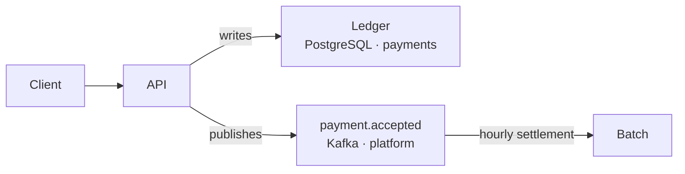

## Summary
Move settlement off the request path and into hourly batches.

## Motivation
Settlement adds 300 ms to p99 checkout latency and fails the whole request when the bank is slow.

## Proposal

The API writes the ledger entry and publishes `payment.accepted`. A batch job reads the topic once an hour and settles in groups.

This relies on the event bus described in [Move the event bus to Kafka](../../platform/adr/0009-move-the-event-bus-to-kafka.md).

> [!CAUTION]
> Customers see "pending" for up to an hour. Support needs a runbook before this ships.

## Open questions
- [ ] Batch size and cut-off time per currency
- [ ] Failure handling for partially settled batches
