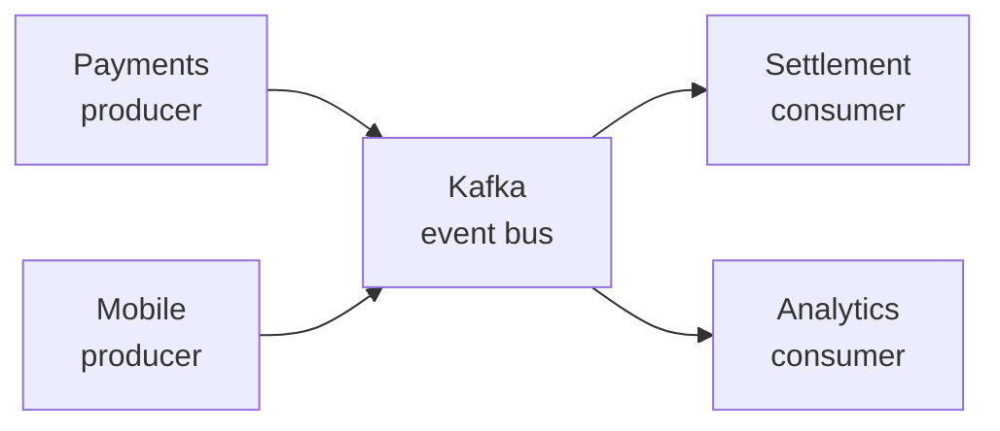

## Context
Replay, ordering and fan-out are now requirements. Queues cannot give us those. The work in [Settle in async batches](../../payments/rfc/0001-settle-in-async-batches.md) needs all three.

## Options
| Option | Replay | Ordering | Ops cost | Verdict |
|---|---|---|---|---|
| Keep SQS | No | Per queue | Low | Rejected |
| Kafka | Yes | Per partition | High | Chosen |
| Pulsar | Yes | Per partition | High | Rejected |

## Decision
Move the event bus to Kafka. Platform owns the clusters.

> [!WARNING]
> Operating Kafka is a platform commitment. Budget two engineers.

## Consequences
- [x] Topic naming convention: `<team>.<entity>.<event>`
- [ ] Migrate the last SQS consumers
