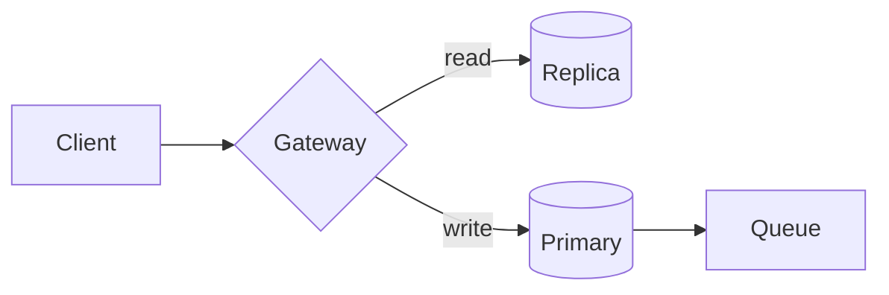
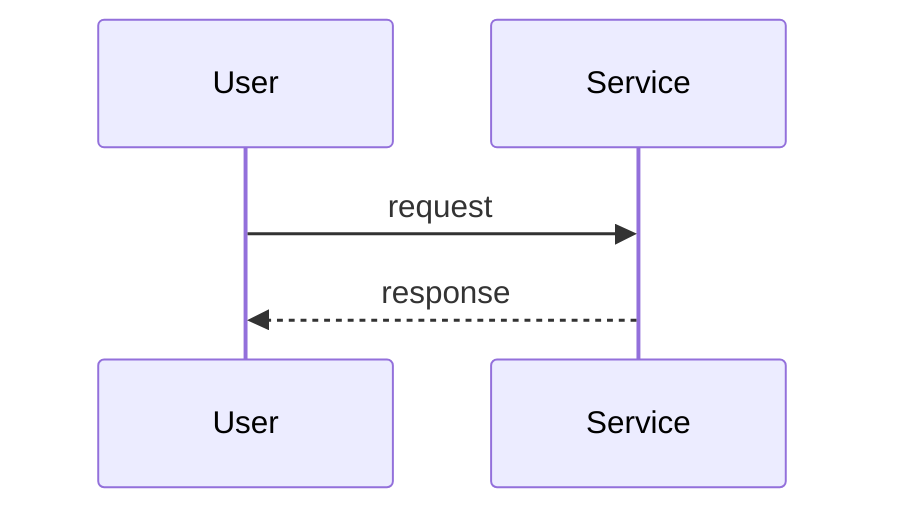

## Paragraphs and inline marks

Body text with **strong**, *emphasis*, ~~strikethrough~~, `inline code`, and a [relative link to another record](../rfc/0001-neighbour.md) next to an [external link](https://example.com/spec). Tracked in PAY-123 and OPS-7, see also a footnote.[^1] Keyboard: <kbd>Ctrl</kbd> + <kbd>K</kbd>.

### A third level heading

#### A fourth level heading

- First item
- Second item with a nested list
  - Nested one
  - Nested two
- Third item

1. Ordered one
2. Ordered two
   1. Nested ordered
3. Ordered three

### Task list

- [x] Write the RFC
- [x] Review with **SRE**
- [ ] Roll out to staging, see PAY-456
- [ ] Announce

## Table

| Option | Latency | Verdict |
| --- | ---: | :---: |
| Queue per tenant | 12 ms | Chosen |
| Shared queue | 40 ms | Rejected |
| Streaming | 8 ms | Proposed |

## Blockquote and alerts

> A plain blockquote. Decisions are made with the information at hand.
>
> Second paragraph of the quote.

> [!NOTE]
> Useful information that users should know, even when skimming.

> [!TIP]
> Helpful advice for doing things better, with `inline code` inside.

> [!IMPORTANT]
> Key information users need to succeed.

> [!WARNING]
> Urgent info that needs immediate attention to avoid problems.

> [!CAUTION]
> Advises about risks or negative outcomes of certain actions.

## Code

```ts title="src/budget.ts" {2} ins={4} del={3}
export function budget(slo: number, days = 30) {
  const minutes = days * 24 * 60; // total window
  const allowed = minutes * (1 - slo);
  const allowed = Math.round(minutes * (1 - slo));
  return allowed;
}
```

```yaml title="decisions/demo/_project.yml"
name: Demo
ink: c
owners: [anna]
```

```bash
npm run build && npm run preview -- --port 4406
```

```
plain text without a language
```

## Math

Inline math $E = mc^2$ sits in a sentence.

$$
\text{budget} = (1 - \text{SLO}) \times T = (1 - 0.999) \times 43200 = 43.2\ \text{min}
$$

## Diagram





## Images and rules


---

Text after the rule.

<details>
<summary>Collapsed details</summary>

Hidden content with a paragraph.

</details>

[^1]: The footnote text, with a [link](https://example.com).
